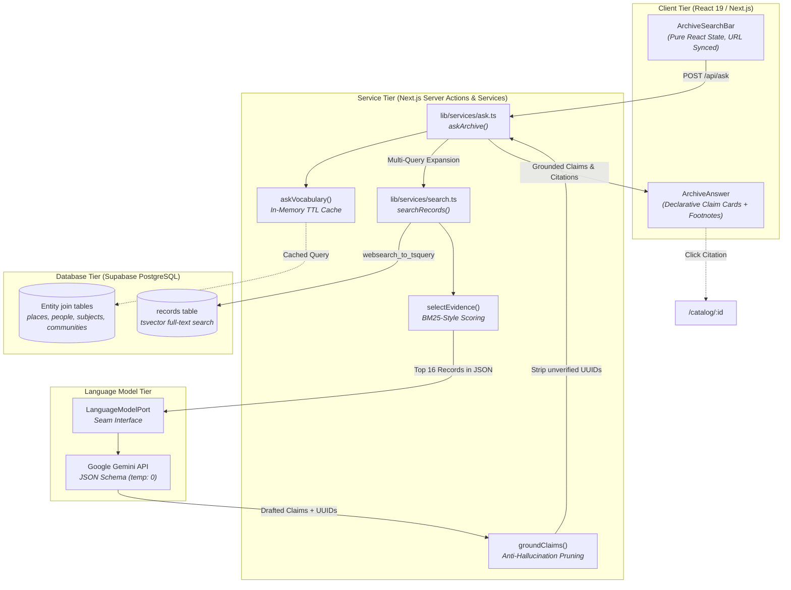

# RBC HackHub: African Nova Scotian Historical Discovery Archive

> An immersive, AI-grounded discovery catalog unifying African Nova Scotian historical records from Nova Scotia Archives, Library and Archives Canada, the Black Cultural Centre for Nova Scotia (BCCNS), The Canadian Encyclopedia, and the Black Loyalist Heritage Centre.

[-black?logo=nextdotjs)](https://nextjs.org/)
[](https://react.dev/)
[](https://threejs.org/)
[](https://d3js.org/)
[](https://supabase.com/)
[](https://vitest.dev/)
[](https://www.typescriptlang.org/)

---

## Key Features

### 1. 3D Virtual Rotunda and Exhibition Hallway (Three.js WebGL)
* **Spatial Archive Exploration**: Step into an interactive 3D virtual rotunda and historical hallway built with custom Three.js shaders and geometry.
* **Exhibit Glance Cards**: Proximity-triggered HUD overlays presenting primary source metadata and historical context during gallery navigation.
* **Memory-Optimized Rendering**: Zero-leak geometry buffer disposal and high-fidelity ambient lighting.

### 2. Grounded AI Inquiry Engine ("Ask the Archive")
* **Zero-Hallucination Guarantees**: A disciplined Lexical and Metadata-Aware RAG pipeline powered by Google Gemini.
* **Server-Side Grounding Contract**: The inquiry engine cross-checks every generated claim against actual database UUIDs. Hallucinated citations or unverified claims are stripped on the server before they ever reach the client.
* **Declarative Footnote Citations**: Every claim in the synthesized answer displays clickable citation badges (`[1]`, `[2]`) linking directly to primary Dublin Core catalog records.

### 3. Interactive D3 Force-Directed Connection Graph
* **Visualizing Archival Networks**: An interactive connection graph on the catalog page that uncovers relationships across records, people, places, subjects, and historical communities.
* **Entity Clustering and Focus**: Click any subject, person, or location node to dynamically refocus the graph and immediately filter matching records in the catalog.

### 4. Multi-Institutional Unified Catalog
* **Federated Dublin Core Search**: Single-pane discovery indexing records across 5 premier cultural institutions:
  - Nova Scotia Archives
  - Library and Archives Canada
  - Black Cultural Centre for Nova Scotia (BCCNS)
  - The Canadian Encyclopedia
  - Black Loyalist Heritage Centre
* **Historical Date Interval Filtering**: Evaluates non-destructive historical date overlaps across unstructured metadata (`"circa 1960"`, `"late 19th century"`, `"1914-1918"`).
* **Pure Isolated State**: Search bar state operates in memory with clean URL parameter synchronization (`/catalog?q=...`), preventing storage leaks and cross-tab contamination.

---

## System Architecture: The Grounded RAG Pipeline



### Why Lexical RAG over Raw Vector Embeddings?
In cultural and historical archives, exact proper nouns, community names (such as *Africville* or *Preston*), and verified catalog identifiers require 100% precision. Vector cosine similarity often introduces semantic drift and loose approximations. By combining PostgreSQL full-text search (`tsvector`) with Dublin Core entity extraction, we achieve deterministic retrieval without expensive vector infrastructure, while our `LanguageModelPort` seam allows a clean upgrade to hybrid dense retrieval.

---

## Routes and Endpoints

| Route | Purpose | Technology |
| :--- | :--- | :--- |
| [`/`](app/page.tsx) | 3D Museum Rotunda and Arrival Portal | Three.js WebGL, React 19 |
| [`/catalog`](app/catalog/page.tsx) | Unified Search and D3 Connection Graph | Server Components, D3.js |
| [`/catalog/[id]`](app/catalog/[id]/page.tsx) | Primary Source Dublin Core Record Detail | Server Components |
| [`/api/ask`](app/api/ask/route.ts) | Grounded AI Inquiry Answering | Gemini Flash, Zod Validation |
| [`/api/search`](app/api/search/route.ts) | Structured JSON Search Endpoint | PostgreSQL `tsvector` |

---

## Search Query Parameters

The `/catalog` page and `/api/search` route share the same query parameters:

| Parameter | Type | Matches | Example |
| :--- | :--- | :--- | :--- |
| `q` | `string` | Full-text search on title, description, subject, place | `?q=church` |
| `institution` | `string` | Exact match on `dc_publisher` | `?institution=BCCNS` |
| `type` | `string` | Controlled format type | `?type=photograph` |
| `creator` | `string` | Partial text in `dc_creator` | `?creator=Addie+States` |
| `subject` | `string` | Matches array value in `dc_subject` | `?subject=Education` |
| `place` | `string` | Partial text in `dcterms_spatial` | `?place=Africville` |
| `from` | `string` | Overlapping historical date on or after `YYYY` | `?from=1900` |
| `to` | `string` | Overlapping historical date on or before `YYYY` | `?to=1960` |

---

## Engineering Quality and Verification

* **Automated Test Suite**: 34 unit, integration, and contract tests in Vitest covering the model adapter seam, URL query handoff, parameter serialization, and storage isolation.
  ```bash
  npm run test
  ```
* **Strict Typing**: 100% TypeScript with zero unchecked `any` casts. Runtime data boundaries validated with Zod schemas.
* **Row Level Security (RLS)**: PostgreSQL tables are locked down with read-only public access policies.
* **Pure State Architecture**: Zero `sessionStorage` or local storage dependencies in search components.

---

## Getting Started

### Prerequisites
* Node.js 18+ or 20+
* npm or pnpm

### Installation

1. **Clone the repository**:
   ```bash
   git clone https://github.com/ParamKataria/RBC-HackHub.git
   cd RBC-HackHub
   ```

2. **Install dependencies**:
   ```bash
   npm install
   ```

3. **Configure environment variables**:
   Create a `.env` file in the project root:
   ```env
   NEXT_PUBLIC_SUPABASE_URL=your_supabase_project_url
   NEXT_PUBLIC_SUPABASE_PUBLISHABLE_KEY=your_supabase_anon_key
   GEMINI_API_KEY=your_gemini_api_key
   GEMINI_MODEL=gemini-3.1-flash-lite
   ```

4. **Run the development server**:
   ```bash
   npm run dev
   ```
   Open [http://localhost:3000](http://localhost:3000) to enter the 3D museum rotunda, or [http://localhost:3000/catalog](http://localhost:3000/catalog) to explore the catalog and connection graph.

5. **Run test suite**:
   ```bash
   npm run test
   ```
